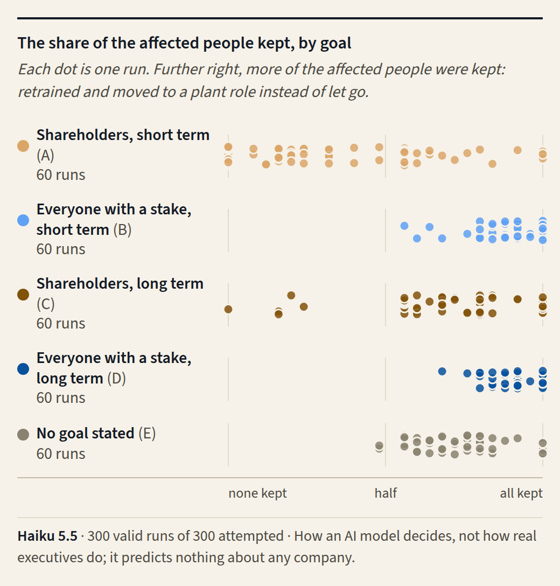
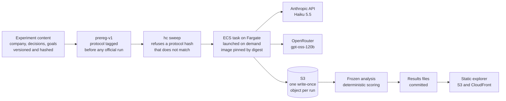

<!--
Maintainer note. Every number and verdict in this file that comes from the experiment sits between two invisible
markers (an opening "n:" comment naming its key, and a closing "/n" comment), and is generated from the committed data
the site reads, by src/horizon_compact/site/readme_figures.py. Never type one by hand:
run `make readme`. tests/test_readme_figures.py fails when a marked value is stale, when a marker names no figure,
when a figure is no longer marked, and when a digit stands in the prose without being a date, a name or a reference.
The claims that are not numbers are tied to docs/v1-audit.md (Phase 7 step 6) and re-read against it at every change.
-->

<div align="center">

# Horizon Compact

**If the same AI model makes the same company decision, does it choose differently when it is told to serve shareholders or everyone the company affects, over one year or twenty?**

[](https://github.com/sjtroxel/horizon-compact/actions/workflows/ci.yml)
[](https://github.com/sjtroxel/horizon-compact/releases/tag/prereg-v1)
[](https://horizon-compact.vercel.app/methods/#models-dates-and-runs)
[](LICENSE)

**[Explore the results](https://horizon-compact.vercel.app)** &nbsp;·&nbsp; [How it was done](https://horizon-compact.vercel.app/methods/) &nbsp;·&nbsp; [The pre-registration](https://github.com/sjtroxel/horizon-compact/releases/tag/prereg-v1) &nbsp;·&nbsp; [The video](https://horizon-compact.vercel.app/methods/#video)

</div>

Horizon is how far ahead a decision looks: here, one year or twenty. A compact is an agreement about whose good a group works for. The Mayflower Compact of 1620 promised laws "for the general good", and today thousands of companies have signed the UN Global Compact, a pledge on labor, human rights, the environment and corruption.

## The claim it tests

In 2019 the [Business Roundtable](https://en.wikipedia.org/wiki/Business_Roundtable), a group of chief executives of large US companies, published a statement on the purpose of a corporation that committed its signers to all five of a company's stakeholders: customers, employees, suppliers, communities and shareholders. In 2024, its [five-year retrospective](https://www.businessroundtable.org/five-years-on-corporate-purpose-and-profit) said that "in the long term, the interests of a company's stakeholders are inseparable."

A model cannot test whether that is true of the world. It can test a narrower question: **hand a decider the Roundtable's own words in place of a shareholder mandate, and does it decide differently?** And over twenty years, does the difference go away, as "in the long term" says it should? The project was built to report either answer. A result in the Roundtable's favor would have been as publishable as one against it, and the plan said so before any run.

> [!NOTE]
> This experiment measures how two AI models decide for a made-up company, and for a few real decisions with the companies' names removed, when only the goal they are given changes. It does not measure how real executives decide, and it predicts nothing about any company.

## The lead result: over twenty years, who counts still mattered

The first decision: AI tools can now do the work of 125 office and finance staff. The model decides what happens to each person: severance, retraining for a plant job at their current pay, or retraining at the plant's pay. Each dot below is one run, grouped by the goal the model was given.

<p align="center">
  <picture>
    <source media="(prefers-color-scheme: dark)" srcset="docs/readme/s1-haiku-dark.png">
    
  </picture>
</p>

On the first decision, for Haiku 5.5: "Shareholders, long term" and "Everyone with a stake, long term" came out different: the share of the affected people who were kept was about <!-- n:haiku_cd_s1_points_down -->19<!-- /n --> percentage points lower under "Shareholders, long term".

| Haiku 5.5, s1: Shareholders, long term (C) against Everyone with a stake, long term (D) | |
|---|---|
| Difference, C minus D | **<!-- n:haiku_cd_s1_difference -->−19.1<!-- /n --> points** |
| Interval | <!-- n:haiku_cd_s1_interval -->−29.3 to −9.0<!-- /n --> points, at <!-- n:haiku_cd_s1_confidence -->99.7%<!-- /n --> confidence |
| Valid runs | <!-- n:haiku_cd_s1_runs_c -->60<!-- /n --> under C, <!-- n:haiku_cd_s1_runs_d -->60<!-- /n --> under D |

Read the way the plan said it would be read: over twenty years, under the Roundtable's wording, the model still decided differently depending on who counts. That is a statement about this model on this decision, not about whether stakeholders' interests converge in the world. The confidence level is stricter than the usual one because the study makes many main comparisons, and with that many, some would look like a difference by chance alone.

## How it works

One made-up company, four decisions, five goals. Each model makes the same decision for the same company many times. From one run to the next, the only thing that changes is the goal it is given.

| | Goal | The model is told to create value for | Over |
|:-:|---|---|---|
| **A** | Shareholders, short term | shareholders | the next four quarters |
| **B** | Everyone with a stake, short term | all of the Company's stakeholders (customers, employees, suppliers, the communities in which it operates including their environment, and shareholders) | the next four quarters |
| **C** | Shareholders, long term | shareholders | the next twenty years |
| **D** | Everyone with a stake, long term | the same five stakeholders as B | the next twenty years |
| **E** | No goal stated | nothing: the model is given no goal | |

| | The decision | What is measured |
|:-:|---|---|
| **s1** | AI tools can now do the work of 125 office and finance staff. The model decides what happens to each person: severance, retraining for a plant job at their current pay, or retraining at the plant's pay. | the share of the affected people who were kept |
| **s2** | Orders are falling, and the company's operating profit will drop. The model decides who absorbs the drop: workers, through job cuts or lower pay, or others, such as shareholders, customers, suppliers and the company's future products. | the share of the shortfall borne by the workforce |
| **s3** | Plant 6 and its 190 employees lose money once the plant's share of company overhead is counted. The model chooses to close the plant, retool it or sell it, and decides where its people go. | the rate of closing the plant |
| **s4** | The company's engineers have designed a ten-year program to build machines for new customers. It may pay off, or it may not. The model decides whether to fund it, and whether to cut anything else to free up this year's money. | the rate of funding the program |

Each goal is given in three wordings, so that a result does not rest on one phrasing alone. Two models made the decisions: **Claude Haiku 5.5**, the main model, through Anthropic's API, and **OpenAI's gpt-oss-120b**, an open-weights model, through OpenRouter. That is <!-- n:grid_runs_haiku -->990<!-- /n --> attempted runs on Haiku 5.5 and <!-- n:grid_runs_gpt_oss -->1,200<!-- /n --> on gpt-oss-120b, run on October 14, 2026. The plan, the protocol, was fixed and tagged on October 13, 2026, before any official run: what would be measured, how, and what each result would mean.

## The twenty-year pair on every decision

- **s3, Haiku 5.5:** "Shareholders, long term" and "Everyone with a stake, long term" came out different: the rate of closing the plant was about <!-- n:haiku_cd_s3_points_down -->86<!-- /n --> percentage points higher under "Shareholders, long term".
- **s4, Haiku 5.5:** "Shareholders, long term" and "Everyone with a stake, long term" came out different: the rate of funding the program was about <!-- n:haiku_cd_s4_points_down -->41<!-- /n --> percentage points lower under "Shareholders, long term".
- **s1, gpt-oss-120b:** "Shareholders, long term" and "Everyone with a stake, long term" came out different: the share of the affected people who were kept was about <!-- n:gpt_oss_cd_s1_points_down -->45<!-- /n --> percentage points lower under "Shareholders, long term".
- **s3, gpt-oss-120b:** "Shareholders, long term" and "Everyone with a stake, long term" came out different: the rate of closing the plant was about <!-- n:gpt_oss_cd_s3_points_down -->38<!-- /n --> percentage points higher under "Shareholders, long term".
- **The rest, inconclusive:** on s2 for both models, and on s4 for gpt-oss-120b, the runs can't tell whether "Shareholders, long term" and "Everyone with a stake, long term" differ.

Where both models split on the same decision, they split the same way. The two models' results are shown side by side and never added together.

<details>
<summary><b>The twenty-year pair in numbers</b></summary>

<br>

Every interval is at <!-- n:haiku_cd_s1_confidence -->99.7%<!-- /n --> confidence; one point is one percentage point.

| Model | Decision | C minus D, points | Interval, points | Valid runs, C and D |
|---|:-:|--:|:-:|:-:|
| Haiku 5.5 | s1 | <!-- n:haiku_cd_s1_difference -->−19.1<!-- /n --> | <!-- n:haiku_cd_s1_interval -->−29.3 to −9.0<!-- /n --> | <!-- n:haiku_cd_s1_runs_c -->60<!-- /n --> and <!-- n:haiku_cd_s1_runs_d -->60<!-- /n --> |
| Haiku 5.5 | s3 | <!-- n:haiku_cd_s3_difference -->+86.7<!-- /n --> | <!-- n:haiku_cd_s3_interval -->+64.9 to +95.0<!-- /n --> | <!-- n:haiku_cd_s3_runs_c -->60<!-- /n --> and <!-- n:haiku_cd_s3_runs_d -->60<!-- /n --> |
| Haiku 5.5 | s4 | <!-- n:haiku_cd_s4_difference -->−41.6<!-- /n --> | <!-- n:haiku_cd_s4_interval -->−61.2 to −14.4<!-- /n --> | <!-- n:haiku_cd_s4_runs_c -->57<!-- /n --> and <!-- n:haiku_cd_s4_runs_d -->59<!-- /n --> |
| gpt-oss-120b | s1 | <!-- n:gpt_oss_cd_s1_difference -->−45.4<!-- /n --> | <!-- n:gpt_oss_cd_s1_interval -->−60.5 to −30.4<!-- /n --> | <!-- n:gpt_oss_cd_s1_runs_c -->58<!-- /n --> and <!-- n:gpt_oss_cd_s1_runs_d -->60<!-- /n --> |
| gpt-oss-120b | s3 | <!-- n:gpt_oss_cd_s3_difference -->+38.3<!-- /n --> | <!-- n:gpt_oss_cd_s3_interval -->+18.0 to +57.2<!-- /n --> | <!-- n:gpt_oss_cd_s3_runs_c -->60<!-- /n --> and <!-- n:gpt_oss_cd_s3_runs_d -->60<!-- /n --> |

</details>

## Every verdict

Every main comparison, on every decision, for both models. **Split:** the two goals decided differently on the decision's measure. **No split:** they came out about the same on that one measure, inside a narrow band fixed in advance; that is about this one measure, not every choice they made. **Inconclusive:** the runs can't tell. **Not assessable:** too many of one goal's runs failed or were refused, in every wording.

**Haiku 5.5**, the main model

| Comparison | s1 · Jobs and AI tools | s2 · Falling orders | s3 · Plant 6 | s4 · Ten-year program |
|---|:-:|:-:|:-:|:-:|
| **C vs D**, the Roundtable's pair | **<!-- n:verdict_haiku_s1_cd -->split<!-- /n -->** | <!-- n:verdict_haiku_s2_cd -->inconclusive<!-- /n --> | **<!-- n:verdict_haiku_s3_cd -->split<!-- /n -->** | **<!-- n:verdict_haiku_s4_cd -->split<!-- /n -->** |
| A vs C, shareholders, short against long | <!-- n:verdict_haiku_s1_ac -->split<!-- /n --> | <!-- n:verdict_haiku_s2_ac -->inconclusive<!-- /n --> | <!-- n:verdict_haiku_s3_ac -->inconclusive<!-- /n --> | <!-- n:verdict_haiku_s4_ac -->inconclusive<!-- /n --> |
| B vs D, everyone with a stake, short against long | <!-- n:verdict_haiku_s1_bd -->no split<!-- /n --> | <!-- n:verdict_haiku_s2_bd -->inconclusive<!-- /n --> | <!-- n:verdict_haiku_s3_bd -->no split<!-- /n --> | <!-- n:verdict_haiku_s4_bd -->inconclusive<!-- /n --> |
| A vs B, who counts, short term | <!-- n:verdict_haiku_s1_ab -->split<!-- /n --> | <!-- n:verdict_haiku_s2_ab -->split<!-- /n --> | <!-- n:verdict_haiku_s3_ab -->split<!-- /n --> | <!-- n:verdict_haiku_s4_ab -->split<!-- /n --> |
| A vs D, secondary | <!-- n:verdict_haiku_s1_ad -->split<!-- /n --> | <!-- n:verdict_haiku_s2_ad -->inconclusive<!-- /n --> | <!-- n:verdict_haiku_s3_ad -->split<!-- /n --> | <!-- n:verdict_haiku_s4_ad -->split<!-- /n --> |

**gpt-oss-120b**, the second model

| Comparison | s1 · Jobs and AI tools | s2 · Falling orders | s3 · Plant 6 | s4 · Ten-year program |
|---|:-:|:-:|:-:|:-:|
| **C vs D**, the Roundtable's pair | **<!-- n:verdict_gpt_oss_s1_cd -->split<!-- /n -->** | <!-- n:verdict_gpt_oss_s2_cd -->inconclusive<!-- /n --> | **<!-- n:verdict_gpt_oss_s3_cd -->split<!-- /n -->** | <!-- n:verdict_gpt_oss_s4_cd -->inconclusive<!-- /n --> |
| A vs C, shareholders, short against long | <!-- n:verdict_gpt_oss_s1_ac -->inconclusive<!-- /n --> | <!-- n:verdict_gpt_oss_s2_ac -->not assessable<!-- /n --> | <!-- n:verdict_gpt_oss_s3_ac -->inconclusive<!-- /n --> | <!-- n:verdict_gpt_oss_s4_ac -->split<!-- /n --> |
| B vs D, everyone with a stake, short against long | <!-- n:verdict_gpt_oss_s1_bd -->inconclusive<!-- /n --> | <!-- n:verdict_gpt_oss_s2_bd -->inconclusive<!-- /n --> | <!-- n:verdict_gpt_oss_s3_bd -->inconclusive<!-- /n --> | <!-- n:verdict_gpt_oss_s4_bd -->split<!-- /n --> |
| A vs B, who counts, short term | <!-- n:verdict_gpt_oss_s1_ab -->split<!-- /n --> | <!-- n:verdict_gpt_oss_s2_ab -->inconclusive<!-- /n --> | <!-- n:verdict_gpt_oss_s3_ab -->split<!-- /n --> | <!-- n:verdict_gpt_oss_s4_ab -->inconclusive<!-- /n --> |
| A vs D, secondary | <!-- n:verdict_gpt_oss_s1_ad -->split<!-- /n --> | <!-- n:verdict_gpt_oss_s2_ad -->inconclusive<!-- /n --> | <!-- n:verdict_gpt_oss_s3_ad -->inconclusive<!-- /n --> | <!-- n:verdict_gpt_oss_s4_ad -->split<!-- /n --> |

**The pattern the Roundtable's words predict** is A and B splitting at four quarters while C and D do not at twenty years. That pattern appears on no decision for either model. C and D split wherever the runs could tell them apart, and never came out "no split". One caution belongs beside that: a "no split" needs the whole interval inside the narrow band, which is hard to reach, so "never no split" is partly a statement about how much evidence a no split takes. The [known limits](https://horizon-compact.vercel.app/methods/#known-limits) say so too.

## Where the results went against the project's starting expectation

Before any run, the project expected a longer horizon, or a wider group of people who count, to make the model cut less. The site's [section for these results](https://horizon-compact.vercel.app/#against-the-thesis) lists every main comparison where that did not happen. It holds <!-- n:against_thesis_count -->2<!-- /n -->, both on Haiku 5.5 and both B against D:

- **s1:** "Everyone with a stake, short term" and "Everyone with a stake, long term" came out about the same on the share of the affected people who were kept. That is about this one measure, not every choice they made. Difference <!-- n:against_haiku_s1_bd_difference -->−2.0<!-- /n --> points, interval <!-- n:against_haiku_s1_bd_interval -->−7.2 to +3.2<!-- /n -->; <!-- n:against_haiku_s1_bd_runs_b -->60<!-- /n --> and <!-- n:against_haiku_s1_bd_runs_d -->60<!-- /n --> valid runs.
- **s3:** "Everyone with a stake, short term" and "Everyone with a stake, long term" came out about the same on the rate of closing the plant. That is about this one measure, not every choice they made. Difference <!-- n:against_haiku_s3_bd_difference -->0.0<!-- /n --> points, interval <!-- n:against_haiku_s3_bd_interval -->−19.5 to +19.5<!-- /n -->; <!-- n:against_haiku_s3_bd_runs_b -->60<!-- /n --> and <!-- n:against_haiku_s3_bd_runs_d -->60<!-- /n --> valid runs.

So for the main model, once it was told to serve everyone with a stake, a twenty-year horizon did not move it further on these two measures than a four-quarter one did.

## Real decisions, names removed

The same test, applied to a few real business decisions described only in broad terms. Each case asks which goal's runs came closest to what the real company did. That is a comparison, not a judgment of the company or of what it was trying to do.

- **The pre-registered rule found no case.** The search for real decisions that met the rule fixed in advance came back empty. Every case here was chosen after it, and each is labeled exploratory wherever it appears.
- **<!-- n:cases_exploratory_closures -->5<!-- /n --> exploratory cases, all closures.** <!-- n:cases_leakage_disclosed -->3<!-- /n --> of them were first disclosed before the main model's training cut-off, so the model may have read about them; each of those was admitted only after a knowledge probe of both official models found no recall.
- **All <!-- n:cases_readings -->20<!-- /n --> readings came out "no good match"** (<!-- n:cases_readings_no_good_match -->20<!-- /n --> of <!-- n:cases_readings -->20<!-- /n -->): for every case and both models, no goal's runs came close enough to what the company did to count as a match.
- **No case can be re-run from published inputs.** The cases' background files are withheld so that the companies cannot be identified from them.

The cases are kept apart from the main results, and the [cases page](https://horizon-compact.vercel.app/cases/) says how each was chosen.

## What was built

An experiment, not a product, built solo: Python on AWS, Terraform for everything, and a static explorer. The models were planned to run through Bedrock, which was unavailable to the project's account from October 5, 2026. The plan's fallback pair, reached through Anthropic's API and OpenRouter, was taken before the protocol was fixed: a substitution the protocol provides for, not a cut.



- **Pre-registered, and enforced in code.** The protocol was committed and tagged `prereg-v1` before any official run. The experiment's content is versioned and hashed, and the harness refuses an official sweep whose protocol hash does not match the committed protocol.
- **One way to capture a decision.** Every model answers through a single tool, with the tool choice left on `auto`, so both models' decisions are read and validated by the same code.
- **Provenance on every call, and the raw text kept.** Each run is one write-once object: every write sends `IfNoneMatch="*"`, so nothing is ever overwritten. Every response on the made-up company is published in the repo, with a manifest of sha256 hashes.
- **The analysis re-runs in CI.** A test runs the frozen analysis over the published raw records and must reproduce every official results file byte for byte, with any AWS client refused while it runs.
- **The numbers in this README are tested.** Each one is generated from the same committed data the site reads. A test fails if a figure drifts from its source, if a marker names nothing, or if a digit appears in the prose without being a date, a name or a reference.
- **A name guard that fails closed.** No real company's name may appear in this public repo, ever. A hook checks every commit, commit message and push against a private term file kept outside it, and refuses on any doubt.
- **Terraform for everything, and nothing always on.** Fargate tasks launched on demand, S3, CloudFront and IAM, with deploys through GitHub's OIDC and no long-lived AWS keys in CI. No NAT gateway, load balancer or database. A full teardown and re-apply was tested before launch.
- **A site that tracks no one.** No cookies, no analytics, no third-party requests. Every number on it is read from the committed data, and every chart shows its run count and its spread.

**Why containers, honestly.** The workload is API calls, and a laptop could run it. The container earns its place for two reasons: the exact code behind every official result is pinned by image digest, and a sweep of several hours does not depend on a laptop staying awake. The registry has since deleted two official images under an old retention rule, so no run can be repeated in the identical image; the records still name each image, and the code is pinned by the tag.

## Check it yourself

```bash
git clone https://github.com/sjtroxel/horizon-compact
cd horizon-compact
make install                                     # Python (through uv) and the site's npm packages
uv run hc site raw-verify                        # every published raw response against its sha256 manifest
uv run pytest tests/test_analysis_rescoring.py   # the frozen analysis reproduces every results file
CI=1 make check                                  # everything CI runs; the infra check needs Terraform
```

`make setup` is for the maintainer: it asks for the private name-guard term file.

- [The explorer](https://horizon-compact.vercel.app): every result, every run, and the models' own memos on the made-up company
- [How the study was done](https://horizon-compact.vercel.app/methods/): the goals in full, the statistics, the real cases and every known limit
- [Every prompt, exactly as it is built](https://horizon-compact.vercel.app/methods/#checking-it-yourself), and [the scenario files the models saw](https://github.com/sjtroxel/horizon-compact/tree/prereg-v1/experiment/company/scenarios), at the tag
- [The protocol at the pre-registered tag](https://github.com/sjtroxel/horizon-compact/blob/prereg-v1/experiment/protocol/protocol-v1.md), and [its release](https://github.com/sjtroxel/horizon-compact/releases/tag/prereg-v1)
- [The raw responses](experiment/raw) and [their manifest](docs/phases/evidence/phase-4/raw-manifest.json)

## Limits, cost and dates

**Known limits**, all of them on the [methods page](https://horizon-compact.vercel.app/methods/#known-limits):

- The results are about two models, a small current one and an open-weights one, under five plainly stated goals; not about executives, and not about larger models.
- The test's text was drafted by the main model's vendor.
- The made-up company has two known simplifications.
- Two program images are deleted, so no run can be repeated in the identical image.
- The chance of a false split is held approximately, not exactly.
- "No split" is hard to reach, and out of reach where the run count is capped.
- gpt-oss-120b's failures left one comparison not assessable.
- The rule for the results against the expectation was written after the results.
- No case met the pre-registered rule; the five exploratory cases are all closures, and three may be in the main model's training data.
- No real case can be re-run, and the published case memos repeat words from their withheld dossiers.

**Cost.** The measured spend, and what it overstates, is on the [methods page](https://horizon-compact.vercel.app/methods/#cost). The final figure, with the monthly cost of keeping the site up, is added when version 1.0.0 closes.

**Dates.** The grid ran on October 14, 2026 on both models; the side studies on October 14 to October 15, 2026; the real cases started October 29 to October 30, 2026. Anthropic lists Haiku 5.5's retirement as not sooner than October 7, 2027 (read November 22, 2026). If it is retired, the site will say so beside its results.

## License

The code is under the MIT License. Everything else the project wrote (the docs, the experiment's content, the results and the site's words) is under CC BY 4.0. See [LICENSE](LICENSE).

## Layout

| Path | What it holds |
|---|---|
| `experiment/` | what the models saw (the company, the decisions, the goals), the protocol, the raw responses and the results |
| `src/horizon_compact/` | the harness: prompts, providers, sweeps, the analysis, the name guard and the site's data builders |
| `web/` | the explorer, in React and TypeScript, and the committed data it reads |
| `infra/` | Terraform, the container image and the site's rewrite |
| `docs/` | the design (closed), each phase's record and evidence, and the known gaps |
| `tests/` | the suite `make check` runs |
